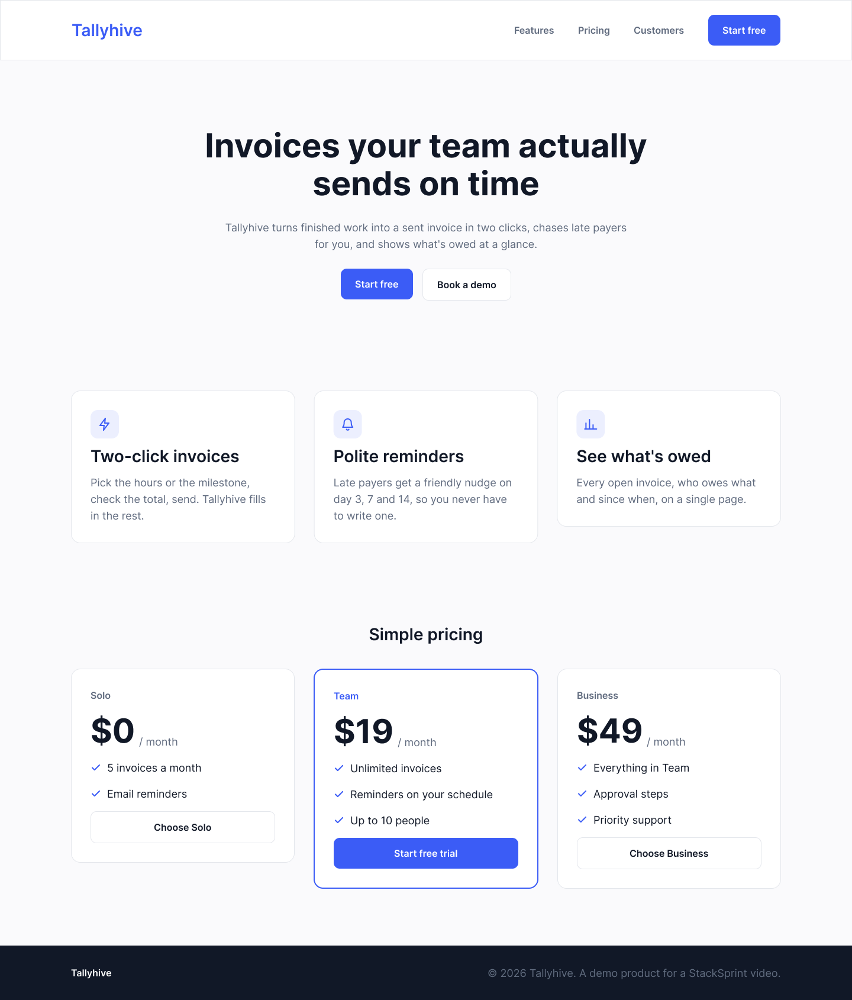

# figma-mcp-py

A small Figma MCP server in Python, built with [FastMCP](https://gofastmcp.com). It gives Claude a design it can build from: the layout as flexbox, the colour and text styles as CSS variables, the icons as SVG, and a picture of the frame to compare against.

It is five read-only tools in about 280 lines of Python, so you can read all of it, change what Claude sees, and run it on Figma's free plan.



*Tallyhive is a made-up product. The mock above is drawn by the plugin in [`mock/`](mock/), so you can draw the same file in your own Figma account and follow along.*

## Why write your own instead of using an existing one

- **You decide what Claude reads.** Figma's file JSON is big: the one-page mock above is about 100 KB, roughly 20k tokens, and Claude Code warns when a tool returns more than 10k tokens (it cuts off at 25k unless you raise `MAX_MCP_OUTPUT_TOKENS`). `get_layout` turns the same frame into about 17 KB of what a developer needs: auto layout as `flex` (direction, gap, padding, justify, align), text with its font, colours as hex, sizes in px, and style names. Everything else is dropped.
- **It works on the free plan.** Figma's REST rate limits put file reads and image exports in Tier 1, and their docs list View and Collab seats at up to 20 of those calls a month. This server makes at most three calls per file (the file, a PNG of the frame, the icons as SVG) and saves each response under `.cache/`. Every tool reads from the cache after that.
- **It's read-only.** No tool writes to Figma, so there's nothing to approve call by call.

## The tools

| Tool | What it returns |
| --- | --- |
| `list_frames(file_url)` | The top-level frames in the file: page, id, name, size. Start here. |
| `get_layout(file_url, frame_id)` | One frame as a compact layout tree. Icons show up as one `icon` node each (name, id, size), not their vector paths. |
| `get_tokens(file_url)` | Colour and text styles as CSS custom properties, for example `--color-brand: #3B5CF6` and `--font-display: 700 56px/64px Inter`. |
| `export_icons(file_url, frame_id)` | Every icon in the frame (any node named `Icon / ...`) as inline SVG, keyed by name. |
| `render_frame(file_url, frame_id)` | A PNG of the frame, returned as an MCP image so Claude can see the design. |

`file_url` is the link you copy from Figma's address bar (`figma.com/design/<file key>/...`); the bare file key works too.

The picture and the tokens do different jobs. From the PNG alone, Claude gets the look right but has to guess exact values (it read our brand blue as roughly `#3D5AFE`); `get_tokens` gives it the real `#3B5CF6`.

## How the code is laid out

```
figma_mcp/
  figma.py      the two Figma REST endpoints (/v1/files, /v1/images), every response cached on disk
  simplify.py   Figma JSON → the compact layout, tokens and icon list (pure functions, no network)
  server.py     the five @mcp.tool() functions; their docstrings are what Claude reads to pick a tool
mock/           a Figma development plugin that draws the Tallyhive mock
tests/          pytest, offline, against a saved copy of the mock
```

## Setup

You need Python 3.12+, [Claude Code](https://docs.claude.com/en/docs/claude-code/overview), and Node.js (only for the Playwright MCP server, see below).

```bash
git clone https://github.com/stacksprint-io/figma-mcp-py.git
cd figma-mcp-py
python3 -m venv .venv
.venv/bin/pip install -e '.[dev]'
.venv/bin/pytest            # 21 tests, all offline
```

### 1. A design to read

Use any Figma file you can open, or draw the Tallyhive mock:

1. Create a new design file in the Figma desktop app.
2. **Plugins → Development → Import plugin from manifest**, pick `mock/manifest.json`, then run **Tallyhive mock**.
3. Copy the file's link from the address bar.

The server works best on designs built with auto layout and named styles, because those are what turn into `flex` and CSS variables.

### 2. A Figma token

In Figma: **Settings → Security → Personal access tokens → Generate new token**, with read-only access to file content. Then:

```bash
cp .env.example .env        # and paste the token after FIGMA_TOKEN=
```

`.env` and `.cache/` are both in `.gitignore`. The token is only needed the first time a file is read; once a file is cached, the server runs without it. To fetch a file again after you change the design, delete its files from `.cache/`.

### 3. Register it with Claude Code

This repo ships a project `.mcp.json` with two servers: this one (`figma`) and Microsoft's official [Playwright MCP](https://github.com/microsoft/playwright-mcp) (`playwright`), which lets Claude open the page it built, take a screenshot and compare it with the design. Start Claude Code in the repo folder, approve the two project servers when it asks, and run `/mcp` to check both are connected.

To add only the Figma server, or to use it from another project:

```bash
claude mcp add figma -- /full/path/to/figma-mcp-py/.venv/bin/python -m figma_mcp.server
```

The Playwright server runs headless at 1440×900. Remove `--headless` from `.mcp.json` if you want to watch the browser.

## Build a page from the mock

Serve an empty `site/` folder (`cd site && python3 -m http.server 8765`), then give Claude Code one prompt:

> Build the landing page in this Figma file as site/index.html: `<your Figma link>`. Use the figma tools to read the frames, the layout, the tokens, the icons and the picture. Plain HTML with Bootstrap 5 from the CDN and a small style block using the tokens as CSS variables; no build step. A server is already serving the site folder at http://127.0.0.1:8765/ (don't start one). When it's written, open it with the playwright tools at 1440 wide, take a screenshot, compare it with the Figma picture, fix what differs, and list what you fixed.

On the Tallyhive mock this produces one HTML file whose sections match the frame's heights to the pixel at 1440 wide. In our test run the compare step found and fixed one real difference: the featured pricing card's 2 px border sits outside its padding in Figma, so the card is 380×372, not 378×370.

## Limits

- It reads one frame at a time and only solid fills. Gradients, images, effects (shadows, blur), components and variants aren't simplified yet; add them in `simplify.node` if your designs need them.
- Fonts are reported by family, size, weight and line height. The page still has to load the font itself (the Tallyhive mock uses Inter).
- Icons are found by name: a node named `Icon / <something>` is exported as one SVG.

## License

MIT
